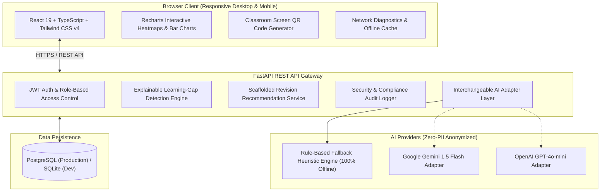

# LearnGap AI 🎓

> **Explainable Classroom Diagnostic Assessments, Learning-Gap Detection, and Targeted Pedagogical Revision.**

[](https://fastapi.tiangolo.com)
[](https://react.dev)
[](https://tailwindcss.com)
[](https://www.postgresql.org)
[-success.svg)](https://pytest.org)
[](#privacy--ethical-ai-guarantees)

---

## 1. Project Overview & Problem Solved

Teachers frequently cannot identify which concepts students have misunderstood until formal examinations—weeks or months after a topic was taught. In typical classrooms:
- Many students hesitate to ask questions due to embarrassment.
- Overall examination marks (e.g., 62%) hide the specific cognitive misconceptions causing the errors.
- One wrong answer does not necessarily prove a deep misconception, but repeated distractor choices indicate systematic patterns (e.g., adding denominators directly across when adding fractions).

**LearnGap AI** solves this problem by enabling teachers to deploy short 3–10 question concept checks, automatically diagnose cognitive misconceptions, visualize learning gaps through an explainable class heatmap, and generate scaffolded revision modules with worked examples—all accessible from any browser within **five minutes**.

---

## 2. System Architecture



---

## 3. Technology Stack

- **Frontend:** React 19, TypeScript, Vite, Tailwind CSS v4, Lucide Icons, Recharts, `qrcode.react`, `canvas-confetti`.
- **Backend:** Python 3.12, FastAPI, Pydantic v2, SQLAlchemy 2.0 ORM, Uvicorn, Passlib (bcrypt), Python-JOSE.
- **Database:** PostgreSQL (Production), SQLite (Zero-config local development and instant automated tests).
- **AI Integration:** Interchangeable AI Service Adapter with a deterministic rule-based fallback that operates 100% offline without downtime.
- **Testing:** Pytest, Pytest-Asyncio, HTTPX, Starlette TestClient.
- **Containerization:** Docker multi-stage builds and Docker Compose.

---

## 4. Key Features

1. **5-Minute Classroom Onboarding Wizard:**
   - Sign in as an approved teacher.
   - Create a class cohort and select subject in 30 seconds.
   - Auto-generate a short 6-character uppercase join code.
   - Display a high-resolution QR code on the classroom smartboard.
   - Students scan and join from phones, tablets, or Chromebooks with zero app installation.
   - Launch quiz and monitor live aggregated submissions.

2. **Question-Level Misconception Diagnosis Engine:**
   - Supports Single Choice, Multiple Choice, Numeric (with tolerance), and Short Text questions.
   - Every question tagged with Subject, Chapter, Topic, Learning Objective, and Difficulty.
   - Distinguishes between verified wrong answers, suspected misconceptions, and unknown causes.
   - Pre-calibrated question bank across Mathematics, Science, English, and Computer Science.

3. **Teacher Diagnostic Dashboard & Class Heatmap:**
   - Accuracy percentage, responses count, and students needing revision calculated per topic.
   - Multi-topic Class Mastery Heatmap Matrix with color bands (Critical Gap `<50%`, Developing Gap `50–70%`, Proficient `>70%`).
   - Statistical confidence levels (High, Moderate, Preliminary for low sample sizes).
   - Configurable review threshold slider (40% to 80%).

4. **Scaffolded Revision Recommendation Engine:**
   - Concise concept explanation.
   - Step-by-step worked example preserving invariance.
   - Three graduated practice questions with progressive hints (Hint 1 → Hint 2 → Full Solution).
   - Short follow-up assessment tracking retention post-revision.

5. **AI Learning Assistant with Teacher Review:**
   - Summarizes class learning difficulties.
   - Explains underlying cognitive root causes.
   - Re-explains concepts at a Grade 6 reading level using everyday analogies.
   - Creates 3-tier differentiated practice (Foundation, Standard, Extension).
   - **Enforces teacher approval before publishing any AI-generated materials.**

6. **Privacy & School Security Console:**
   - **Zero student PII transmitted to external AI.**
   - No public leaderboards or competitive ranking to prevent student embarrassment.
   - Emergency kill switch to immediately revoke compromised join codes school-wide.
   - Audit trail of administrative actions, data exports, and retention purges.

---

## 5. Quickstart & Local Installation

### Prerequisites
- Node.js `v18+` and `npm`
- Python `3.11+` or `3.12`

### 1. Clone & Set Up Backend
```bash
# Navigate to backend directory
cd backend

# Create Python virtual environment
python -m venv venv

# Activate virtual environment
# Windows:
.\venv\Scripts\activate
# Linux/macOS:
source venv/bin/activate

# Install dependencies
pip install -r requirements.txt

# Run database migrations and seed demonstration school curricula
python -m app.seed.seed_data

# Start FastAPI server
uvicorn app.main:app --reload --port 8000
```
Backend API will be running at `http://localhost:8000` (Swagger docs at `http://localhost:8000/api/docs`).

### 2. Set Up Frontend
```bash
# In a new terminal, navigate to frontend directory
cd frontend

# Install npm dependencies
npm install

# Start Vite development server
npm run dev
```
Open `http://localhost:5173` in your browser.

---

## 6. Running Automated Tests

LearnGap AI includes an automated test suite covering authentication, RBAC, class creation, join code revocation, quiz submissions, scoring, duplicate prevention, misconception detection, learning gap engine math, AI fallback, and network diagnostics:

```bash
cd backend
.\venv\Scripts\pytest -v
```

Output:
```text
tests/test_all_features.py::test_demo_login_teacher PASSED               [  9%]
tests/test_all_features.py::test_demo_login_student PASSED               [ 18%]
tests/test_all_features.py::test_user_registration PASSED                [ 27%]
tests/test_all_features.py::test_duplicate_registration_fails PASSED     [ 36%]
tests/test_all_features.py::test_class_creation_and_join_code PASSED     [ 45%]
tests/test_all_features.py::test_quiz_creation_with_misconception_rules PASSED [ 54%]
tests/test_all_features.py::test_student_join_valid_and_invalid_codes PASSED [ 63%]
tests/test_all_features.py::test_quiz_submission_and_duplicate_prevention PASSED [ 72%]
tests/test_all_features.py::test_learning_gap_engine_analysis PASSED     [ 81%]
tests/test_all_features.py::test_ai_rule_based_fallback PASSED           [ 90%]
tests/test_all_features.py::test_network_diagnostics_ping PASSED         [100%]

======================= 11 passed in 2.46s =======================
```

---

## 7. Production Deployment

### Option A: Docker Compose (Full Stack with PostgreSQL)
```bash
# Copy example environment configuration
cp .env.example .env

# Build and start PostgreSQL, Backend API, and Nginx SPA
docker-compose up -d --build
```
Your application will be live on `http://localhost` (Port 80) with PostgreSQL persistence.

### Option B: Managed Cloud Deployment
1. **Database:** Deploy a managed PostgreSQL instance (e.g., Supabase, Neon, AWS RDS, DigitalOcean). Set `DATABASE_URL` in environment variables.
2. **Backend API:** Deploy the `backend/` directory to Render, Railway, AWS ECS, or Fly.io with `uvicorn app.main:app --host 0.0.0.0 --port $PORT`.
3. **Frontend:** Deploy the `frontend/` directory to Vercel, Netlify, or Cloudflare Pages with build command `npm run build` and output directory `dist`.
4. **Environment Variables:** Set `SECRET_KEY`, `DATABASE_URL`, and optionally `GEMINI_API_KEY` or `OPENAI_API_KEY`.

---

## 8. Connecting a School Custom Domain

If your institution uses a custom domain (e.g., `learngap.greenwood.edu`):
1. In your DNS provider (Cloudflare, AWS Route 53, GoDaddy), create a `CNAME` record pointing `learngap.greenwood.edu` to your deployed frontend host.
2. Ensure your SSL/TLS certificate is active (automated Let's Encrypt / Cloudflare SSL).
3. Update `BACKEND_CORS_ORIGINS` in your backend configuration to include your custom domain.

---

## 9. Known Limitations & Future Roadmap

- **Audio/Speech Responses:** Currently supports single choice, multiple choice, numeric, and text answers. Spoken answer transcription is planned for early language acquisition.
- **LMS Synchronization:** Direct LTI 1.3 / Google Classroom two-way roster synchronization is scheduled for v1.2.
- **Handwritten Formula Recognition:** OCR scanning for student paper work is in research preview.

---

## 10. License & Compliance
Built in compliance with the Indian Digital Personal Data Protection (DPDP) Act, FERPA, and ethical classroom AI guidelines.
