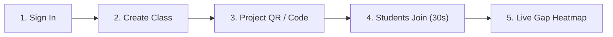

# LearnGap AI: School Onboarding & Implementation Guide

Welcome to **LearnGap AI**! This guide is designed for school principals, STEM department heads, classroom teachers, and school IT administrators to get an entire school operational within **five minutes**.

---

## 1. Five-Minute Teacher Quickstart

LearnGap AI requires no complex software installation, app store downloads, or student email collection.

### Step 1: Sign in with Approved Teacher Account
1. Open your browser and navigate to your LearnGap deployment URL (e.g. `https://learngap.school.edu`).
2. Click **Sign In** (or click **Demo Teacher** for instant preview).
3. Your educator account grants role-based access to create classes, deploy concept checks, and view diagnostic heatmaps.

### Step 2: Create a Class in 30 Seconds
1. In the top bar or dashboard, click **Launch 5-Min Quiz** or **Classes & Codes**.
2. Enter your cohort name (e.g., *Grade 8 Mathematics - Period 2*) and select the subject.
3. LearnGap automatically generates a clean, 6-character alphanumeric join code (e.g. `MATH8A`).

### Step 3: Project the Classroom QR Code
1. Click **Display Screen Code**.
2. A high-resolution QR code and large 6-character code will appear on screen.
3. Project this onto your classroom smartboard or projector.

### Step 4: Students Join Instantly
1. Students point their smartphone or tablet camera at the QR code, or open their browser and enter the 6-character code.
2. Students enter their school-approved nickname (e.g. *Alex C.*).
3. **Zero app installation** or personal account creation is required for students.

### Step 5: Administer Concept Check & View Results
1. Students complete the 3–5 question diagnostic check.
2. The **Learning-Gap Engine** immediately calculates accuracy, flags topics under the 60% threshold, and pinpoints specific misconceptions.
3. Deploy the step-by-step **Scaffolded Revision Module** with worked examples and progressive hints.

---

## 2. School IT Administrator & Network Allowlist Guide

### Network Infrastructure & Compatibility
LearnGap AI is architected as a lightweight, secure web application designed to run smoothly on standard school Wi-Fi and student devices (Chromebooks, iPads, Windows, Android, and macOS laptops).

### Firewall Allowlist Configuration
If your school network enforces strict outbound URL filtering or next-generation firewall inspection (e.g., Fortinet, Palo Alto Networks, Cisco Umbrella, Sophos), ensure the following ports and endpoints are allowlisted:

| Protocol | Port | Destination | Purpose |
| :--- | :--- | :--- | :--- |
| **HTTPS** | `TCP 443` | `*.learngap.school.edu` (Your App Domain) | Application & REST API traffic |
| **HTTP** | `TCP 80` | `*.learngap.school.edu` | Automatic redirect to HTTPS |
| **DNS** | `UDP/TCP 53` | Standard School DNS resolvers | Domain resolution |

> [!NOTE]
> **No Internal School Server Required:** LearnGap AI runs entirely as a standard web application. It does not require incoming firewall ports, local school server hosting, or internal VPN tunneling.

### Network Diagnostics Tool
Teachers or IT administrators can verify browser and firewall readiness at any time by navigating to `/diagnostics` (or clicking **Diagnostics** in the navigation bar). The automated tool checks:
- Secure Context (HTTPS/TLS)
- HTML5 Web Crypto API
- LocalStorage caching for Wi-Fi reconnection tolerance
- Live API ping and latency

---

## 3. Privacy, Safety, and Ethical AI Safeguards

### 1. Zero Student PII Transmitted to AI
When AI assistance is invoked, LearnGap AI transmits only anonymized, aggregate concept numbers (e.g., *"18 students answered; Topic: Fraction Arithmetic; Accuracy: 42%; Distractor: Added numerators directly across"*). **No student names, emails, student IDs, or demographic records are ever sent to external AI providers.**

### 2. Interchangeable AI with 100% Offline Rule-Based Fallback
LearnGap AI includes a deterministic, pedagogical heuristic rule-based engine. Even if cloud AI services are unreachable, offline, or disabled, **all core learning gap analysis and revision recommendations remain 100% operational.**

### 3. Non-Pejorative Educational Vocabulary
Our diagnostic engine strictly prohibits derogatory or stigmatizing labels. Students are never characterized as "weak", "slow", or "failing". Feedback focuses on cognitive misconceptions and procedural steps.

### 4. Confidentiality & No Public Leaderboards
Student assessment results are strictly private between the student and their authorized teacher. LearnGap AI does not feature public mark comparisons or competitive leaderboards to protect student emotional safety.

### 5. Configurable Data Retention & Purging
School administrators can configure data retention periods (30 days, 90 days, or 365 days) from the **School Admin Console**. Expired assessment records can be permanently purged in compliance with school governance and the Indian Digital Personal Data Protection (DPDP) Act.

---

## 4. Emergency Join Code Revocation

If a class join code is ever shared outside the classroom:
1. Teachers can click **Disable Code** under **Classes & Codes** to immediately deactivate the code.
2. School Administrators can enter the code into the **Emergency Revoke** field in the **School Admin Console** to invalidate it school-wide with an audit trail entry.
